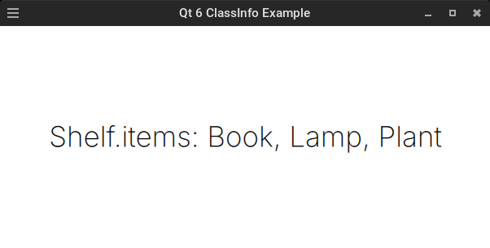
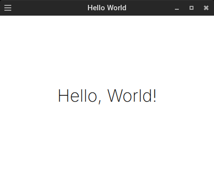
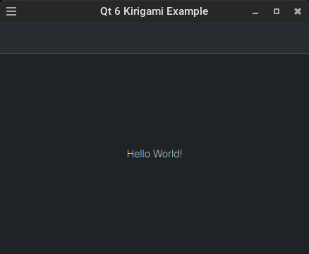
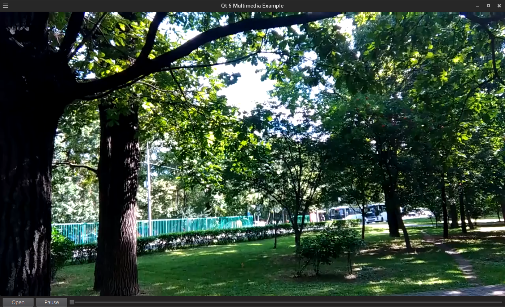
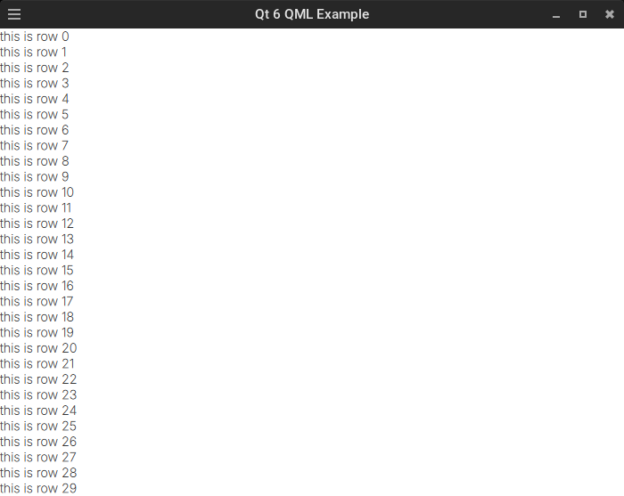
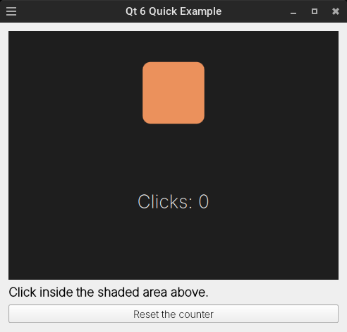
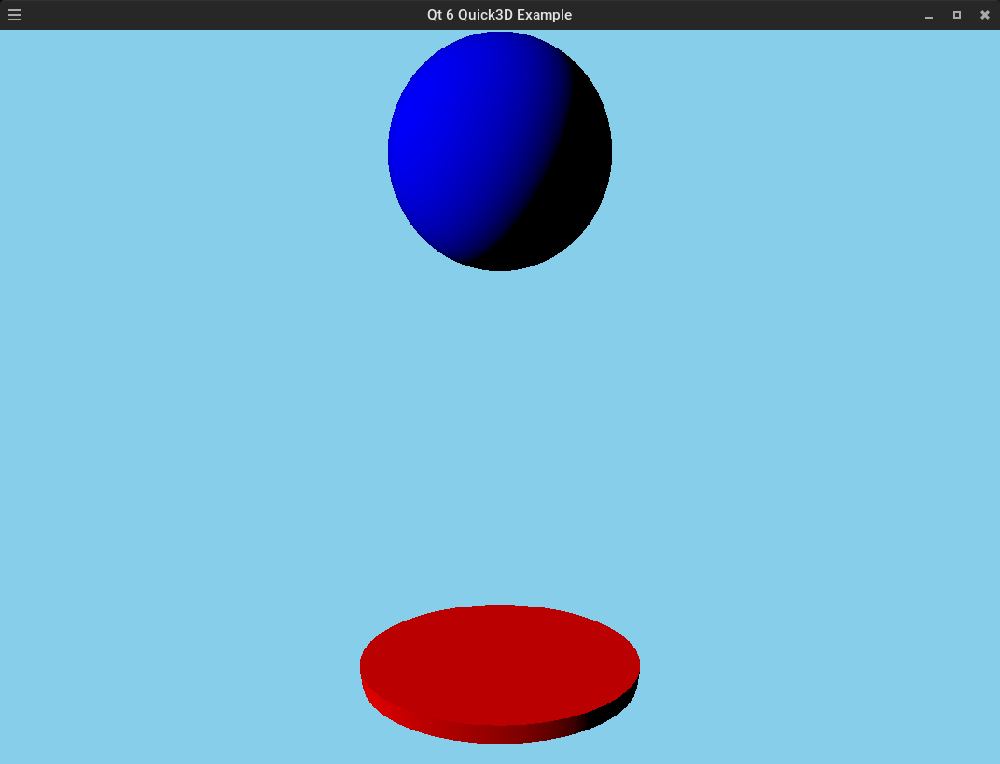
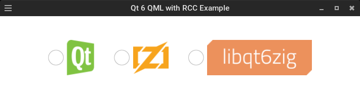
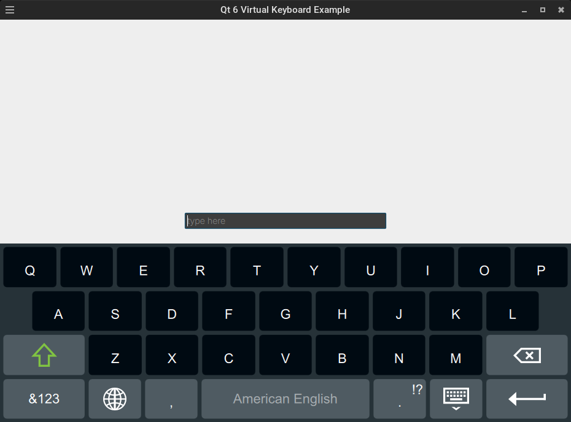
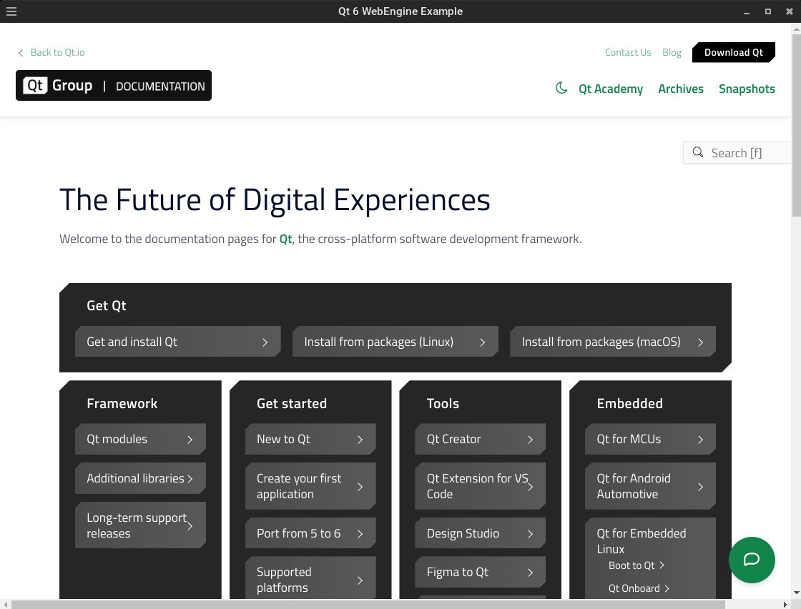

# OVERVIEW

This document represents a simpler representation of the current examples. There are innumerable insights to be gained from studying the programs, so that is still encouraged for the curious. Clicking on the example will open the related directory containing the source code and any auxiliary files.

As a reminder, the examples have a unique and slightly complicated structure because of the shared central build system. For a simpler and more straightforward demonstration using a single application, the [demo](https://github.com/rcalixte/libqt6zig-demo) was created with that purpose in mind.

---

[classinfo](src/libraries/qml/classinfo)

---

[helloworld](src/libraries/qml/helloworld)

---

[kirigami](src/libraries/extras/kirigami)

---

[multimedia](src/libraries/multimedia)

---

[qml](src/libraries/qml/qml)

---

[quick](src/libraries/quick)

---

[quick3d](src/libraries/restricted-extras/quick3d)

---

[rcc](src/libraries/qml/rcc)

---

[virtualkeyboard](src/libraries/restricted-extras/virtualkeyboard)

---

[webengine](src/libraries/webengine)

---

